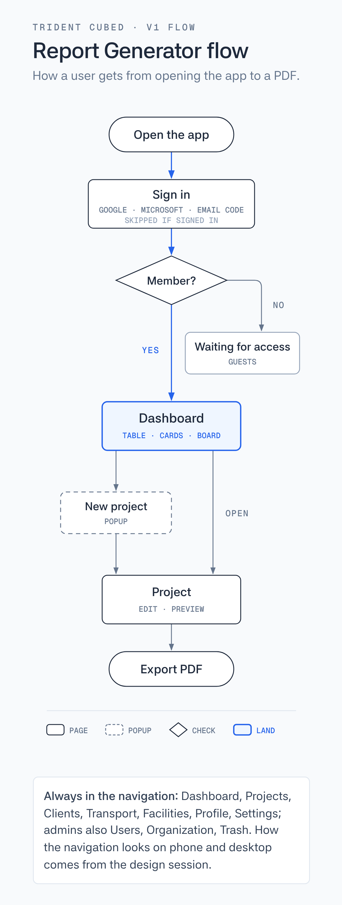

# Report Generator pages

The pages (routes) of the Report Generator: the end goal, and the part that ships in V1. Decided on "💬 app: Decide the V1 pages and how they connect" ([#159](https://github.com/layerdbiz/tridentcubed/issues/159)), 2026-10-10. How the pages look, and how the navigation behaves on a phone and a desktop, is decided by the design prototypes that follow.

## The pages

✅ = V1. Everything else is the end goal, built after V1.

- Anyone
  - Sign in ✅ (Google, Microsoft or an emailed code; ADR 0002)
    - Enter code ✅
  - Privacy policy ✅ (may live on the Website)
  - Terms ✅ (may live on the Website)
- Signed in
  - Waiting for access ✅ (what a Guest sees until an admin lets them in)
  - Dashboard ✅ (where staff land; in V1 it is the same list as Projects)
  - Projects ✅
    - Project ✅ (the Workspace)
      - Page (photos or a map of the trip, then its details; design prototype run 13)
      - Edit ✅
      - Preview ✅ (zoom, page layouts, Export PDF)
      - Photos
      - History
      - Sent copies
  - Customers ✅
    - Customer (record page, Page and Edit; design prototype run 12)
  - Team ✅ (one Team record per person; design prototype run 16)
    - Team (record page, Page and Edit)
  - Transport ✅ (filtered by Sea, Air, Rail, Road; reads Transport Mode in the design prototype from run 12)
    - Transport (record page, Page and Edit; design prototype run 12)
  - Facilities ✅
    - Facility (record page, Page and Edit; design prototype run 12)
  - Notifications
  - Search
  - Profile ✅
  - Settings ✅ (Install app, Sign out, Remove my data from this device; ADR 0007)
  - Help
- Admin
  - Users ✅
    - User
  - Organization ✅ (its details and the report's disclaimer and sign-off; the design prototype's Settings screen, run 15)
    - Report templates
  - Trash ✅
  - Activity log
- Customer portal
  - My projects
  - Request a report
- Super admin
  - Organizations
- Always there
  - Not found / error ✅

## How they connect

1. Opening the app goes to Sign in, skipped when already signed in.
2. Staff (Admin, Manager or Team) land on the Dashboard; a Guest lands on Waiting for access.
3. From the Dashboard a User opens a project, or makes one with New project, a popup (title and customer; whoever makes it is the Owner).
4. A project opens on its Workspace, Edit and Preview; Preview exports the PDF.
5. The navigation always reaches Dashboard, Projects, Customers, Transport, Facilities, Profile and Settings; admins also reach Users, Organization and Trash.

## Rules

- **One list, three views.** Dashboard, Projects, Customers, Transport, Facilities, Users and Trash are the same list component with different data. Table, Cards and Board (a column per label: project status, customer type, team label, transport type, facility kind) are all V1, and the User picks the view; a change of view applies to every page.
- **Customers, Transport and Facilities get their own list pages** on top of being picked and added from dropdowns in the Project details panel and the Transport panel's stops (ADR 0005). Each opens its own record page, one screen shared by all four, with a Page tab first and an Edit tab.
- **New project is a popup,** not a page.
- **No Welcome walkthrough in V1.** The phone asks for the camera, location or microphone the first time a feature needs it. A walkthrough at first sign-in stays on the list for later.
- **No Offline page.** Once signed in the app runs from the device (ADR 0007); opening it for the first time with no signal shows a message on Sign in.
- **Still open for the design prototypes:** what the navigation is on a phone (a bottom bar, a floating bar, or none, as in ChatGPT) and on a desktop (a slim icon rail), and whether a desktop shows Edit and Preview side by side as one screen, panels on the left and the live preview on the right.

The flowchart's source is [pages-flow.html](pages-flow.html).

## What "Sign in and save to the real database" ships

Spec [#179](https://github.com/layerdbiz/tridentcubed/issues/179), 2026-11-12, ships the look prototype's screens on the real database. Where the look prototype settled something differently from the lists above (the Page tab, the Team page, a project made by the plus and opened on Edit with its maker as Team Lead, the organization edited on a Settings screen), the look prototype wins.

Ships:

- Sign in, with Enter code: one form, an emailed code, Google and Microsoft each shown once set up; no password.
- Waiting for access.
- Dashboard, Projects, Customers, Team, Transport (reads Transport Mode) and Facilities, each in Table, Cards and Board.
- Project: Page, Edit and Preview, with Download.
- The record pages of all four kinds, Page and Edit.
- Settings, as the look prototype's screen: the organization's details, which only an Admin changes. Sign out sits in the account menu.
- Not found / error.

V1 pages that wait for a later spec:

- Privacy policy and Terms.
- Profile.
- Users, and the Trash's screen (deleted things already go to the Trash).
- Settings' Install app and Remove my data from this device, which come with offline editing (ADR 0007).
